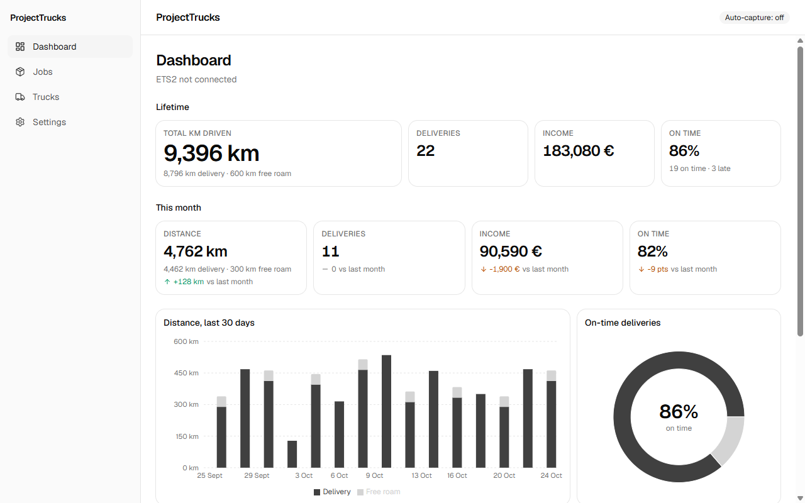
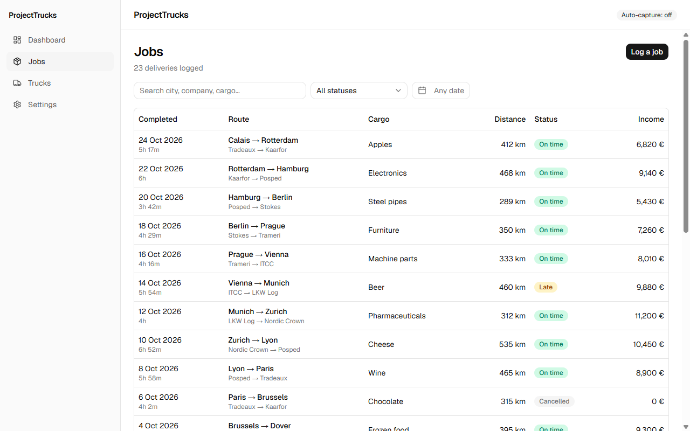
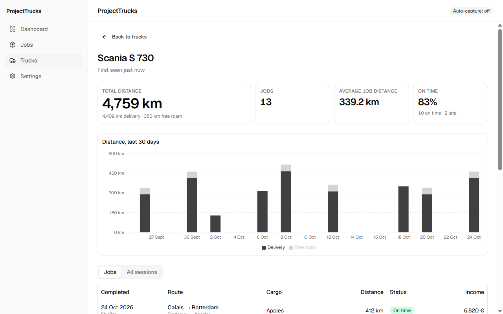

# ProjectTrucks

[](https://github.com/PunterDigital/project-trucks/actions/workflows/ci.yml)

A local Euro Truck Simulator 2 delivery tracker. Runs on your own machine, reads
telemetry while you play, and writes every kilometre and every job to a local
SQLite database. No accounts, no cloud, no telemetry-back-to-us.

**Status:** **Roadmap complete, M1–M4 (v0.5.0).** Deliveries and free-roam
drives are captured from ETS2 automatically through the bundled telemetry
plugin, or logged by hand. There is a dashboard with lifetime and monthly
stats and a 30-day chart, a page per truck, a searchable job history, CSV
export and a one-click database backup. The architectural plan is in
[PLAN.md](PLAN.md); the milestone-by-milestone implementation plan is in
[CLAUDE_CODE_PLAN.md](CLAUDE_CODE_PLAN.md); what changed in each version is
in [CHANGELOG.md](CHANGELOG.md).

Licensed under **MIT** (see [LICENSE](LICENSE)). The bundled plugin DLL is
also MIT (built from
[Funbit/ets2-sdk-plugin](https://github.com/Funbit/ets2-sdk-plugin)) —
provenance is in [assets/telemetry-plugin/README.md](assets/telemetry-plugin/README.md).

## Screenshots







## Install

ProjectTrucks is **Windows only** (Windows 10 or 11, 64-bit). It needs no
account and talks to nothing on the internet.

1. Download the latest `ProjectTrucks_<version>_x64-setup.exe` from the
   [downloads page](https://punterdigital.github.io/personal-apps/) or the
   [GitHub Releases](https://github.com/PunterDigital/project-trucks/releases).
   (The `.msi` on the same release installs the same thing; use it if you
   prefer MSI, for example for a scripted install.)
2. Run it. **Builds are unsigned**, so Windows SmartScreen shows
   "Windows protected your PC": click **More info**, then **Run anyway**.
   Your browser may also ask you to keep the download for the same reason.
3. Follow the installer. ProjectTrucks appears in the Start menu; the WebView2
   runtime it uses is already part of Windows 11 and the installer fetches it
   on Windows 10 if it is missing.
4. Updating: from the version after v0.5.0 on, ProjectTrucks checks for a new
   release when it starts and shows **Update to vX.Y.Z**. One click downloads
   the installer, closes the app and reopens it on the new version (turn the
   check off under Settings → Updates). Running the newer installer over the
   old install by hand works too. Your data stays where it is (see
   [Back up and restore](#back-up-and-restore-your-data)).

v0.1.0 also shipped a macOS `.dmg` for manual logging; later versions don't,
because the telemetry plugin only exists for Windows.

## Set up live capture from ETS2

ProjectTrucks reads the game through a small telemetry plugin (the MIT-licensed
[Funbit/ets2-sdk-plugin](https://github.com/Funbit/ets2-sdk-plugin), bundled
with the app). Once it is installed, every delivery and free-roam drive is
recorded while you play.

1. Open ProjectTrucks. On first launch it shows **Set up live telemetry?**
   with your ETS2 folder found through Steam. Click **Install**. That's it.
   (**Not now** hides the banner until a new plugin version ships.)
2. If you skipped that, or Steam didn't find the game: go to **Settings**,
   check the **ETS2 folder** (click **Detect**, or paste the folder that holds
   `bin\win_x64\eurotrucks2.exe`), then under **Telemetry plugin** click
   **Install plugin**. The status badge turns to **Installed**. The plugin goes
   into `<ETS2 folder>\bin\win_x64\plugins`; a different plugin already there is
   kept as a `.bak`.
3. Under **Auto-capture**, tick **Record drives and deliveries from ETS2
   automatically**.
4. Start Euro Truck Simulator 2. The first launch after installing a plugin
   shows a one-time "advanced SDK features" dialog from the game: click **OK**.
   Keep ProjectTrucks running (it can sit in the background) and drive.

Each finished delivery shows up under **Jobs** with its distance, duration,
truck, cargo, income and on-time / late / cancelled outcome; a stretch without
a job is a free-roam session on the truck's page. A record that looks wrong
(average speed over 150 km/h, under 1 km) is marked **Flagged** so you can
check it and clear the flag on the job page.

When a newer plugin ships with an update, the banner comes back with
**Update**; Settings shows **Update plugin**.

## What you can do today

- **Auto-capture from ETS2.** Install the telemetry plugin from Settings (the
  app offers it on first launch), switch auto-capture on and play: every
  delivery and every free-roam stretch is recorded with its distance, duration,
  truck, cargo, income and on-time / late / cancelled outcome. Suspicious
  records (impossible average speed, under 1 km) are flagged for you to check.
- **Dashboard.** Lifetime and this-month kilometres (delivery vs free roam),
  deliveries, income and on-time rate with month-on-month deltas, a 30-day
  distance chart, an on-time donut and your most recent jobs.
- **Log a job by hand** at `/jobs/new` when you'd rather not run the plugin.
  Every column is editable, with client-side validation.
- **Browse the history** at `/jobs`. Search across city/company/cargo, filter
  by status, narrow by completed-at date range, paginate at 25 rows per page.
- **Open any job** at `/jobs/:id` for the full record. Notes, flagged and flag
  reason save as you type. Delete with a confirm dialog.
- **See your fleet** at `/trucks`: every truck driven with its delivery /
  free-roam split, and a page per truck with its own stats, 30-day chart, jobs
  and driving sessions.
- **Your data is yours.** Export every job to CSV or save a snapshot of the
  database from Settings. The local SQLite file is the only copy; nothing is
  sent anywhere.

## Prerequisites (Windows)

- Rust toolchain (`rustup` stable) — verify with `rustc --version`
- Node.js 20+ and `pnpm` — verify with `node --version` and `pnpm --version`
- Microsoft C++ Build Tools (required for native Rust crates)
- WebView2 runtime (preinstalled on Windows 11; bundled by the Tauri installer
  otherwise)

The Tauri 2 CLI ships as a local devDependency, so you don't need a global
install.

## Local development

```sh
# install frontend dependencies
pnpm install

# run the desktop app in dev mode (vite + cargo run + window)
pnpm tauri dev
```

First launch will compile the full Tauri dep tree from scratch — expect ~2
minutes on a warm cache. Subsequent runs are incremental (~10–30 s).

## Build a production bundle

```sh
pnpm tauri build
```

This produces the NSIS installer under `src-tauri/target/release/bundle/nsis/`
and an MSI under `src-tauri/target/release/bundle/msi/`. Either installs as a
normal Windows app. The app icon comes from `assets/icon/projecttrucks.svg`
(regenerate the sizes with `pnpm tauri icon assets/icon/projecttrucks.svg`).

## Back up and restore your data

Everything lives in one SQLite file:

```
%APPDATA%\co.shaypunter.projecttrucks\projecttrucks.db
```

**Back up.** In **Settings → Your data**, click **Back up database** and pick
where to save the `.db` snapshot (it is a consistent copy, safe to take while
the app is running). **Export jobs to CSV** writes every job to a spreadsheet-
friendly file if you want the data elsewhere.

**Restore.** Close ProjectTrucks, copy your backup over
`%APPDATA%\co.shaypunter.projecttrucks\projecttrucks.db` (rename the current
file first if you want to keep it), and start the app again. A backup from an
older version is fine: schema migrations are append-only SQL files under
`src-tauri/migrations/` and run automatically on every launch.

Uninstalling leaves that folder in place, so a reinstall picks your data up
again; delete the folder yourself if you want it gone.

## Report a problem

Open an issue at
[github.com/PunterDigital/project-trucks/issues](https://github.com/PunterDigital/project-trucks/issues)
with the ProjectTrucks version (the installer's file name has it), what you
did, what you expected and what happened. For a capture that came out wrong,
the job's details (route, distance, the **Flagged** reason if any) and
whether the drive involved a ferry, a cancel or alt-tabbing out of the game
help most; a CSV export of the job is ideal.

## Project layout

```
src/                React frontend (Vite + TypeScript + Tailwind v4 + shadcn/ui)
  components/       UI primitives (shadcn) + app components (Sidebar, Header,
                    DateRangePicker, JobStatusBadge)
  routes/           One file per top-level page (Dashboard, Jobs, JobNew,
                    JobDetail, Trucks, TruckDetail, Settings)
  lib/              api wrapper, formatters, hooks
  types.ts          Hand-mirrored wire types for the Rust command surface
src-tauri/          Rust backend
  migrations/       SQL migrations applied by sqlx at startup
  src/db/           Pool, AppState, models, truck-rollup helper
  src/commands/     Tauri commands (sessions, jobs, trucks, db)
  tests/            Integration tests against in-memory SQLite
```

## Useful scripts

```sh
pnpm dev             # vite dev server only (no Tauri window)
pnpm build           # tsc + vite build (frontend bundle)
pnpm tauri dev       # full app
pnpm tauri build     # release installer

cd src-tauri && cargo test          # all Rust tests (unit + integration)
cd src-tauri && cargo clippy        # Rust lints (CI runs with -D warnings)
pnpm typecheck                      # TypeScript (app + E2E)
pnpm lint                           # ESLint
pnpm test                           # Vitest unit tests
pnpm tauri build --no-bundle && pnpm test:e2e   # Playwright E2E against the real app (Windows)
```

The E2E suite launches the built app with a throwaway data directory
(`PROJECTTRUCKS_DATA_DIR`), so it never touches your real database.

## Contributing

This is a personal project, but the code is MIT — feel free to fork. There's
no contribution process yet.
